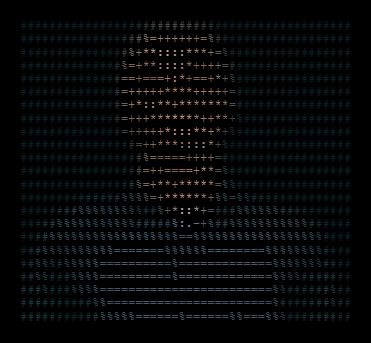

  

<table>
<tr>
<td width="60%" valign="top">

<h1>Hi, I'm Abdlazeez Olasunkanmi 👋</h1>

Full-Stack Developer interning at <b>DGICT Technologies</b>, working across React/Next.js, NestJS, TypeScript, and PostgreSQL. Also finishing my Electrical &amp; Electronics Engineering degree at the <b>University of Ibadan</b>.

📍 Based in Ibadan, Nigeria

<h2>🛠️ Core Tech Stack</h2>

<b>Frontend</b> 
   
  
<b>Backend</b> 
   
  
<b>DevOps &amp; Database</b> 
    

<h2>📊 GitHub Stats</h2>

<h2>🚀 Featured Projects</h2>

<ul>
  <li><b><a href="LINK">Nigerian Student Housing Platform</a></b> — Full-stack marketplace helping students find verified, affordable accommodation. React/TypeScript frontend live on Vercel; PostgreSQL-backed API in active development.</li>
  <li><b><a href="LINK">Portfolio</a></b> — My personal site showcasing projects and writing.</li>
  <li><b><a href="LINK">Husniyyah Luxe Design</a></b> — Client website for a handmade design business, built with TypeScript.</li>
  <li><b><a href="LINK">Audira Landing Page</a></b> — Landing page project, TypeScript.</li>
</ul>

<h2>📫 Let's Connect</h2>

</td>
<td width="40%" valign="top" align="center">

 

 

  

</td>
</tr>
</table>

  

