  

<table width="100%">
<tr>
<td width="50%" valign="middle">

<h1>Hi, I'm Abdlazeez Olasunkanmi 👋</h1>

Full-Stack Developer interning at <b>DGICT Technologies</b>, working across React/Next.js, NestJS, TypeScript, and PostgreSQL.

📍 Based in Ibadan, Nigeria

 

  

</td>
<td width="50%" valign="middle" align="center">

</td>
</tr>
</table>

<h2 align="center">🛠️ Core Tech Stack</h2>

<table width="100%">
<tr>
<td width="33%" align="center" valign="top">
<b>Frontend</b>  
 
 
 

</td>
<td width="34%" align="center" valign="top">
<b>Backend</b>  
 
 
 

</td>
<td width="33%" align="center" valign="top">
<b>DevOps &amp; Database</b>  
 
 
 
 

</td>
</tr>
</table>

<h2 align="center">📊 GitHub Stats</h2>

<table width="100%">
<tr>
<td width="50%" align="center"></td>
<td width="50%" align="center"></td>
</tr>
</table>

<h2>🚀 Featured Projects</h2>

<ul>
  <li><b><a href="LINK">Nigerian Student Housing Platform</a></b> — Full-stack marketplace helping students find verified, affordable accommodation. React/TypeScript frontend live on Vercel; PostgreSQL-backed API in active development.</li>
  <li><b><a href="LINK">Portfolio</a></b> — My personal site showcasing projects and writing.</li>
  <li><b><a href="LINK">Husniyyah Luxe Design</a></b> — Client website for a handmade design business, built with TypeScript.</li>
  <li><b><a href="LINK">Audira Landing Page</a></b> — Landing page project, TypeScript.</li>
</ul>

<h2 align="center">📫 Let's Connect</h2>

  
  

